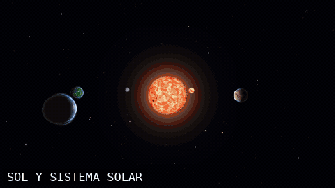

# Sistema solar de Star Wars — Software Renderer (Proyecto Final de Gráficas por Computadora)

Renderizador por software (rasterizador) escrito desde cero en **Rust**, con un pequeño sistema solar explorable con una nave:
Sol, cinco planetas (Tatooine, Hoth, Endor, Mustafar, Coruscant) y la Estrella de la Muerte, cada uno con shader propio, relieve por ruido, objetos sobre la
superficie, gravedad, colisión y un modo de control local para rodear los planetas. Sin motor de juego, sin física externa y sin
imágenes externas: **todas las texturas son procedurales**.

> **raylib solo se usa en `src/platform.rs`** para abrir la ventana, leer teclado/mouse, medir tiempo y subir el framebuffer como
> textura 2D. Todo lo demás (matemáticas, OBJ, clipping, rasterización, z-buffer, shaders, ruido, fuente del HUD) es código propio de este repositorio.



[](https://youtu.be/9m8pVMjY7IE)

_Recorrido: vista general del sistema y aproximación a Tatooine, Hoth, Endor, Mustafar, Coruscant y la Estrella de la Muerte, con sobrevuelo bajo en **modo local** y, al final, un **salto de hiperespacio (warp)** (generado con `--record`, ver opciones abajo)._

## Compilar y ejecutar

Requisitos: Rust estable reciente (edición 2024, `cargo`), y para compilar raylib: `cmake`, un compilador de C y `libclang`
(en Ubuntu/WSL: `sudo apt install cmake build-essential libclang-dev libx11-dev libxrandr-dev libxi-dev libxcursor-dev libxinerama-dev libgl1-mesa-dev`).

```bash
cargo run --release                       # juego interactivo (ventana 1280x720, render interno 960x540)
cargo run --release -- --seed 7           # otra distribución de objetos de superficie
cargo test --release                      # tests (OBJ, frustum/oclusión, objetos de superficie)
```

Modo de pruebas **sin ventana** (genera un PPM; conviértelo con `ffmpeg -i salida.ppm salida.png`):

| Opción | Efecto |
|---|---|
| `--screenshot f.ppm --frames N` | simula N cuadros (dt fijo 1/60 s) y guarda el último |
| `--cam "x,y,z,yaw,pitch"` | cámara fija (ángulos en grados) |
| `--ship x,y,z --planet i` | coloca la nave mirando al planeta `i` (0 Tatooine, 1 Hoth, 2 Endor, 3 Mustafar, 4 Coruscant, 5 Estrella de la Muerte) |
| `--hold W,Shift,A` | teclas mantenidas durante la simulación |
| `--time T` / `--seed N` | instante inicial de simulación / semilla |
| `--nocull`, `--nolod`, `--wire`, `--flat`, `--nohud`, `--fp` | desactivar culling/LOD, wireframe, shader plano, sin HUD, primera persona |
| `--record pref --frames N --every K` | guarda un cuadro cada K como `pref_0000.ppm…` (para armar GIF/video con ffmpeg) |
| `--bench N` | mide N cuadros y muestra ms/cuadro, FPS y contadores (comparar con/sin `--nocull`, `--nolod`) |

## Controles

| Tecla | Acción |
|---|---|
| **W / S** | empuje / freno |
| **A / D** | guiñada (izquierda / derecha) |
| **Q / E** | alabeo |
| **↑ / ↓** | cabeceo |
| **Shift** | turbo |
| **Espacio / Ctrl** | subir / bajar altitud (**modo local**) |
| **← / →**, o **botón derecho + mouse** | mirar alrededor (la cámara vuelve sola al centro) |
| **G** | **warp**: salto de hiperespacio al planeta (o Sol) hacia el que apunta la proa |
| **C** | alternar tercera / primera persona |
| **P** | pausa |
| **[ / ]** | bajar / subir la escala de tiempo (órbitas y rotaciones) |
| **F1** | mostrar/ocultar HUD |
| **F2** | alternar culling (frustum, horizonte y caras traseras) |
| **F3** | alternar LOD (con LOD apagado todo se dibuja al máximo detalle) |
| **F4** | wireframe |
| **Esc** | salir |

El **modo local** se activa solo al acercarte a un planeta (a menos de 2.2 radios) y se indica en el HUD ("MODO LOCAL: …"); al alejarte (>2.6 radios) vuelve al modo espacial sin transición de escena.

## Integrantes y contribución (completar)

| Integrante | Carnet |
|---|---|---|
| Javier Alvarado | 24546 | 

## Características del menú que solicitamos evaluar y dónde verlas

Los parámetros ajustables están todos en `src/config.rs`.

| Característica (pts) | Dónde está | Cómo verla en la demo |
|---|---|---|
| **Planetas distinguibles** que orbitan, rotan y se ven de cerca (10 c/u, 5) | `scene.rs` (`planet_pos`, `planet_model`), `planet.rs`, `config::PLANETAS`, `shaders/*.rs` | Volar a cada planeta; `[`/`]` aceleran órbitas y rotaciones |
| **Tipos de modelo de superficie** (5 c/u, 4) | `assets/surface/*.obj`, `surface.rs`, `config::SUPERFICIE` | Árboles en Endor, vaporizadores en Tatooine, picos en Hoth, rascacielos en Coruscant. **Hoy son PLACEHOLDER (ver abajo)** |
| **Distribución procedural reproducible** (10) | `surface.rs::distribuir` (Fibonacci + fBm + distancia mínima), `--seed` | Ejecutar dos veces con la misma semilla (igual) y con otra (distinta) |
| **Posición y orientación sobre superficie curva, con rotación** (5) | `planet.rs::surface_point/surface_normal`, `scene::planet_rigid`, test `surface::tests` | Rodear un planeta con árboles/edificios: giran con él sin flotar ni hundirse |
| **Shaders propios distinguibles** (6 c/u, hasta 4) | `shaders/{sun,tatooine,hoth,endor,mustafar,coruscant,deathstar}.rs` | Cada planeta con su efecto (granulación, desierto+normales, hielo con vetas, océanos+nubes en remolino, corteza roja con lava, nodos urbanos, paneles metálicos+luces) |
| **Shader animado** (8) | `shaders/sun.rs` (fBm con domain-warp) y `shaders/mustafar.rs` (lava que fluye y pulsa) | Observar el Sol y Mustafar un rato (o con `]` para acelerar el tiempo) |
| **Mapeo de normales** (8) | `texture.rs::ripple_normal_map`, `mesh.rs::compute_tangents`, `shaders/mod.rs::aplicar_normal_map`, `shaders/tatooine.rs` | Acercarse a Tatooine: rizos de arena que reaccionan a la luz |
| **Deformación de geometría por ruido** (10) | `planet.rs::altura_norm` + `mesh.rs::deform_radial`, `noise.rs` | F4 (wireframe) y silueta de los planetas |
| **Generación/subdivisión procedural de geometría antes de rasterizar** (10) | `mesh.rs::subdivide_sphere`, `planet.rs::build_lods`, `mesh.rs::simplify_clustering` | F4 en un planeta cercano (12 288 triángulos) vs lejano (192) |
| **Modo de control local** (8) | `app.rs::actualizar_modo`, `ship.rs` (`LocalFrame`, alineación y retención de altitud), `camera.rs` | Acercarse a un planeta: aparece "MODO LOCAL"; Espacio/Ctrl suben y bajan, rodear sin cortar el vuelo |
| **Aceleración, frenado y giro progresivos, consistentes entre equipos** (8) | `ship.rs::update` (todo escalado por `dt`, `smooth(k, dt)`, amortiguación exponencial) | Soltar W y observar la inercia; los FPS no cambian la respuesta |
| **Atracción gravitatoria** (10) | `scene.rs::gravity` (`g = G·M/(r²+ε)`), `ship.rs::update` (integración semi-implícita) | Soltar la nave cerca de un planeta: cae/se desvía; el HUD muestra `G` |
| **Colisión básica** (4) | `ship.rs::collide_sphere`, `app.rs::collide_ship` (usa la misma función de altura) | Volar contra un planeta o el Sol |
| **Descartar objetos fuera de la vista** (7) | `culling.rs` (frustum de 6 planos + oclusión por horizonte/Sol), `app.rs::render` | **F2** y el HUD ("OBJ dibujados/totales", "FRUSTUM") |
| **LOD por distancia** (8) | `planet.rs::lod_level` (4 niveles de planeta), `app.rs::render` (objetos: completo/simple/omitido) | **F3** y el HUD ("LOD: …", "LOD-OMIT") |
| **Warp animado** (20) | `warp.rs`, `app.rs::try_warp/update_warp`, `stars.rs`, `ship.rs::turn_towards` | Apuntar a un planeta y pulsar **G**: estrellas estiradas, túnel de líneas, FOV abierto, viñeta azul y destello al llegar. Headless: `--warp N` |
| **Coherencia visual y composición** (5) | `stars.rs` (estrellas con parpadeo), `app.rs::halo_solar`, paleta de planetas | Vista general desde lejos |
| **Claridad de la experiencia** (5) | `hud.rs` (fuente bitmap propia, controles en pantalla, indicador de modo) | HUD siempre visible (F1 lo oculta) |

### Rendimiento medido (referencia)

Equipo de desarrollo: 24 hilos; resolución interna 960×540; `cargo run --release -- --bench 40 …`.

| Escena | con culling+LOD | sin culling | sin LOD | sin ambos |
|---|---|---|---|---|
| Endor de cerca (árboles) | 7.5 ms (133 FPS), 4 675 tris rasterizados | 12.9 ms, 23 174 | 7.7 ms | 13.8 ms, 24 704 |
| Vista general lejana | 4.7 ms, 2 476 tris enviados | 5.4 ms | 7.2 ms, 61 804 enviados | 9.1 ms |

(Con 1 hilo, un planeta llenando la pantalla tarda ~100 ms; el reparto en bandas lo baja a ~12 ms. `RENDER_THREADS` en `config.rs`.)
